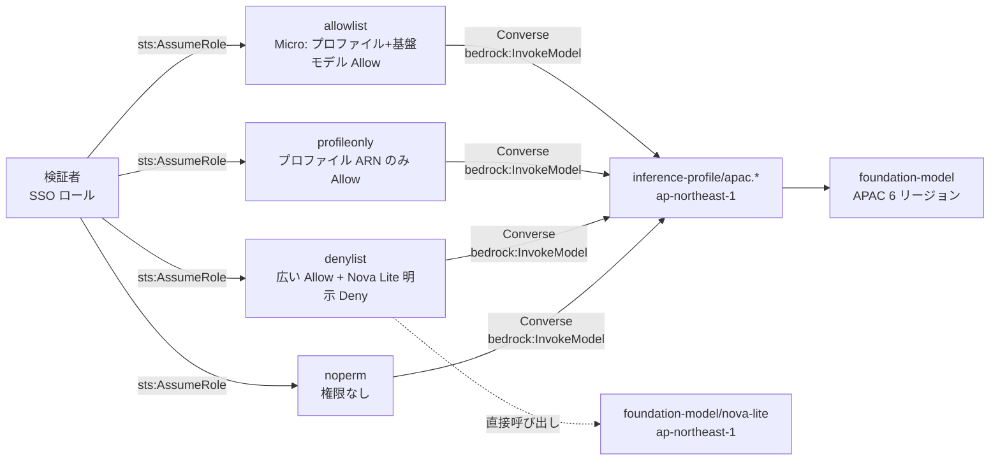

# Lab 01: Amazon Bedrock IAM アクセス制御

記事タイトル案: 「Amazon BedrockのIAMポリシーでモデル利用を制限してみた」

> **ステータス: AWS 実環境で 8 シナリオ検証済み（2026-11-07）**。結果は [docs/results/lab01-bedrock-iam.md](../docs/results/lab01-bedrock-iam.md)、記事下書きは [docs/articles/lab01-bedrock-iam.md](../docs/articles/lab01-bedrock-iam.md)。ロールは検証後も残っており、`terraform destroy` は承認待ち。

## 目的
IAM でモデル利用範囲を制御できることを、実 AWS で **許可・暗黙 Deny・明示 Deny** を比較して実証する。

## アーキテクチャ（東京リージョン ap-northeast-1）



### 事前調査で確認した東京の事実（実環境の `list-foundation-models` / `get-inference-profile`）
- Nova Micro: **推論プロファイル経由のみ**（ON_DEMAND 直接呼び出し不可）
- Nova Lite: 直接(ON_DEMAND)とプロファイルの両方
- `apac.amazon.nova-micro-v1:0` のルーティング先: ap-northeast-1/2/3, ap-south-1, ap-southeast-1/2
- 公式要件: クロスリージョンプロファイルを使うには「プロファイル ARN」と「ルーティング先の基盤モデル ARN」の両方を Allow

## 検証シナリオ（8 回の Converse 呼び出し）

| ID | ロール | 呼び出し先 | 期待 | 確認すること |
|----|--------|-----------|------|--------------|
| S1 | allowlist | Micro（`apac.` プロファイル） | 成功 | 許可モデルは使える |
| S2 | allowlist | Lite 直接 | 暗黙 Deny | Allow に無いものは拒否 |
| S3 | allowlist | Lite（`apac.` プロファイル） | 暗黙 Deny | 同上（プロファイル経路） |
| S4 | profileonly | Micro（プロファイル） | 暗黙 Deny（仮説） | プロファイル ARN だけでは不足か |
| S5 | denylist | Micro（プロファイル） | 成功 | 広い Allow の挙動 |
| S6 | denylist | Lite 直接 | 明示 Deny | Deny は Allow に勝つ |
| S7 | denylist | Lite（プロファイル） | 明示 Deny（仮説） | プロファイル経由でも Deny を回避できないか |
| S8 | noperm | Micro（プロファイル） | 暗黙 Deny | ベースライン |

S4・S7 は**仮説**。実測で異なれば、その結果が記事の発見になる。

## IAM ポリシーの設計判断

| 設計 | 理由 |
|------|------|
| Action は `InvokeModel` / `InvokeModelWithResponseStream` のみ | Converse / ConverseStream もこの 2 つで認可される。管理系 (`bedrock:*`) は不要 |
| Resource を プロファイル ARN + ルーティング先基盤モデル ARN で個別指定 | モデル単位の許可リスト。ワイルドカード `*` を避ける。基盤モデル ARN の列挙は AWS 側のルーティング先変更に追従が必要（運用上のトレードオフ） |
| denylist ロールの広い Allow | **比較実験専用**。本番は allowlist 方式を推奨（新モデル追加で自動的に許可されるのを防ぐ） |
| Deny のリージョンを `*` | クロスリージョン推論でルーティング先リージョンが変わっても Deny が効くように |
| `max_session_duration = 3600` | ロールセッションを最短に |

## 前提条件
- Python 3.12+、Terraform >= 1.6（**この Mac には未インストール**: `brew install terraform`）
- AWS 認証（`aws login` / SSO）。検証者に必要な権限は下記
- Bedrock のモデルアクセス: 現行では多くの Amazon 公式モデルは自動で有効。拒否/未有効エラーの場合は Bedrock コンソールで確認

### 検証者（あなた）に必要な権限
Terraform 実行用: `iam:CreateRole/DeleteRole/GetRole/PutRolePolicy/DeleteRolePolicy/GetRolePolicy/ListRolePolicies/ListAttachedRolePolicies/TagRole/UntagRole/ListInstanceProfilesForRole`（`arn:aws:iam::<acct>:role/lab01-bedrock-*` に限定推奨）、`sts:GetCallerIdentity`
検証実行用: `sts:AssumeRole`（上記 3 ロール）

## 手順（承認後に実施）

```bash
cd aws-ai-security-labs
source .venv/bin/activate

# 1. 計画確認（変更内容を必ず確認）
cd 01-bedrock-iam/terraform
export AWS_PROFILE=personal   # aws sso login --sso-session personal-sso 済みであること
terraform init
echo 'trusted_principal_arn = "arn:aws:iam::<ACCOUNT>:role/aws-reserved/sso.amazonaws.com/ap-northeast-1/AWSReservedSSO_AdministratorAccess_<ID>"' > terraform.tfvars  # gitignore 済み
terraform plan -out=tfplan        # 作成されるのは IAM ロール 4 + インラインポリシー 3 のみのはず

# 2. 適用（承認後）
terraform apply tfplan
mkdir -p ../../docs/results/raw
terraform output -json > ../../docs/results/raw/tf_outputs.json

# 3. 検証実行（Converse 8 回 = 課金）
cd ../..
PYTHONPATH=01-bedrock-iam/src python -m bedrock_iam_lab.cli \
  --tf-output docs/results/raw/tf_outputs.json --confirm-real-calls

# 4. 統合テスト（任意。同じ 8 回がもう一度走る）
LAB01_TF_OUTPUT=docs/results/raw/tf_outputs.json pytest -m integration

# 5. 削除
cd 01-bedrock-iam/terraform && terraform destroy
```

## 削除後の確認
```bash
aws iam list-roles --query "Roles[?starts_with(RoleName,'lab01-bedrock-')].RoleName"   # 空配列なら OK
```
タグ `Project=aws-ai-security-labs` でも棚卸し可能。

## 費用
- IAM ロール/ポリシー: 無料。継続課金リソース: **なし**
- Converse 呼び出し: 成功するのは最大 2〜3 回（S1, S5 ほか）、各 入力約 10 / 出力 最大 20 トークン。Nova Micro は最安クラスで **合計 1 円未満の見込み**（単価は [Bedrock 料金ページ](https://aws.amazon.com/bedrock/pricing/) で実施前に再確認）
- 拒否された呼び出しはモデルが動かないため課金対象外の想定（実測後に確認）

## テスト
```bash
pytest                    # モック単体テストのみ（AWS 接続なし）
pytest -m integration     # 実 AWS（要 apply 済み・課金あり）
```
> モックテストが通っても、IAM の制御が働いたことの証明にはならない。証明するのは統合テスト / CLI の実測結果のみ。

## 既知の確認事項（実測で確定させる）
- AccessDenied の文言が `classify.py` の判定文字列と一致するか
- S4 / S7 のプロファイル経由の挙動（クロスリージョン時に必要な Resource の組み合わせ）
- Nova Micro/Lite が当該アカウントで追加のモデル有効化を要求しないか（東京のモデル一覧では ACTIVE）

## 参考
- [Geographic cross-Region inference（IAM ポリシー要件）](https://docs.aws.amazon.com/bedrock/latest/userguide/geographic-cross-region-inference.html)
- [Supported Regions and models for inference profiles](https://docs.aws.amazon.com/bedrock/latest/userguide/inference-profiles-support.html)
- [Amazon Nova Micro モデルカード](https://docs.aws.amazon.com/bedrock/latest/userguide/model-card-amazon-nova-micro.html)
- [Amazon Bedrock 料金](https://aws.amazon.com/bedrock/pricing/)
