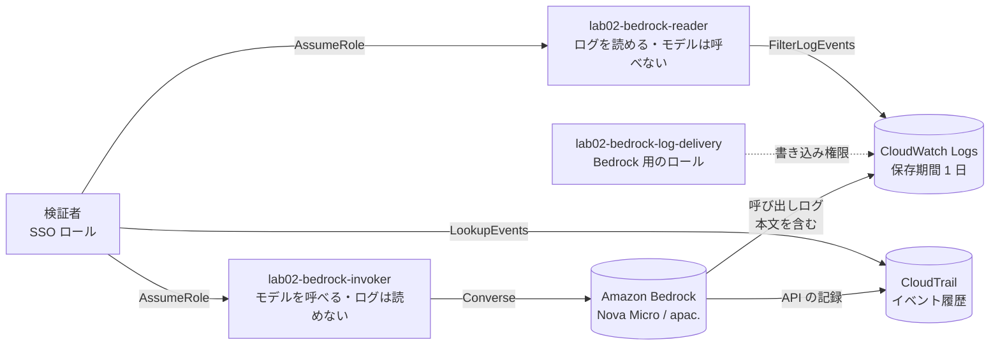

# Lab 02: Amazon Bedrock ログ・監査

記事タイトル案: 「Amazon Bedrockの利用履歴をCloudTrailとCloudWatchで追跡してみた」

> **ステータス: AWS 実環境で検証済み（2026-11-23）**。結果は [docs/results/lab02-bedrock-logging.md](../docs/results/lab02-bedrock-logging.md)。検証用リソースは `terraform destroy` で削除済み。

## 目的
Bedrock の利用を、2種類のログで追跡できるかを確かめる。

| ログ | 何が残るか（公式ドキュメント） | 設定 |
|---|---|---|
| **CloudTrail**（API の監査ログ） | 誰が・いつ・どのモデルを呼んだか | 既定で記録（Converse は管理イベント） |
| **モデル呼び出しログ**（CloudWatch Logs） | 上記に加えて、**プロンプトと応答の本文**（100KB まで）とトークン数 | 既定は無効。アカウント × リージョン単位で有効にする |

## アーキテクチャ（東京リージョン ap-northeast-1）



## 検証すること

| ID | 内容 | 期待（仮説） |
|---|---|---|
| L1 | 通常のプロンプトで Converse | 呼び出しログと CloudTrail の両方に、同じ requestId の記録が残る |
| L2 | **架空の個人情報**（`taro.yamada@example.com`、`090-0000-0000`）を含むプロンプトで Converse | 呼び出しログには**そのまま残る**。CloudTrail には残らない（ドキュメントに記載がないため実測で確認） |
| A1 | reader ロールでログを読む | 読める |
| A2 | invoker ロールでログを読む | 拒否される（モデルを呼べる人と、ログを読める人を分けられる） |
| R1 | 処理されたリージョン（`inferenceRegion`）がどちらかのログに残るか | 呼び出しログには欄がない（ドキュメント）。CloudTrail は不明（ストリーミングの完了イベントにはある） |

R1 は、Lab 01 で残った「実際にどのリージョンで処理されたか」の確認です。

## 設計判断

| 判断 | 理由 |
|---|---|
| **apply の前に preflight で既存のログ設定を確認し、あれば中止** | ログ設定はアカウント × リージョンに 1 つ。Terraform は既存の設定を上書きし、destroy で削除してしまう |
| CloudTrail のトレイルは作らない | Converse は管理イベントで、無料のイベント履歴で確認できる。リソースと費用を増やさない |
| ログの保存期間は 1 日（最短） | 呼び出しログにはプロンプト本文が残るため、長く保存しない |
| KMS のカスタマー管理キーは使わない | 月額がかかるため。CloudWatch Logs の既定の暗号化を使う（本番では検討） |
| Bedrock 用ロールの信頼ポリシーに `aws:SourceAccount` / `aws:SourceArn` | 自分のアカウントの Bedrock からの利用に限定する（公式ドキュメントの形） |
| 書き込み権限は決まったログストリームだけ | `.../log-stream:aws/bedrock/modelinvocations`（公式ドキュメントの形） |
| invoker と reader を分ける | 「モデルを使える人」と「プロンプトの中身を読める人」を分ける |
| 記録するのはテキストだけ | 画像・埋め込みは今回使わない |
| 結果の保存時に、アカウント ID と架空の個人情報を伏せる | 結果を公開する前提のため |

## 注意（重要）
- **ログを有効にしている間は、このアカウントの東京リージョンでの Bedrock の呼び出しが、すべて本文ごと記録されます。** 他のアプリで東京の Bedrock を使っている場合、その内容も記録されます。検証が終わったら、すぐに `terraform destroy` してください。
- 検証時（2026-11-23）は、apply の直前に preflight で、東京のモデル呼び出しログが**未設定**であることを確認しました。destroy 後も未設定に戻っています。

## 前提と必要な権限
- Lab 01 と同じ環境（Terraform、AWS CLI、Python、SSO ログイン、`trusted_principal_arn`）
- apply する人に必要な権限: CloudWatch Logs のロググループ作成・削除、IAM ロールの作成・削除、`iam:PassRole`（Bedrock 用ロールを渡すため）、`bedrock:Put/Get/DeleteModelInvocationLoggingConfiguration`
- 検証を実行する人に必要な権限: 2つのロールへの `sts:AssumeRole`、`cloudtrail:LookupEvents`

## 手順（承認後に実施）

```bash
cd aws-ai-security-labs
source .venv/bin/activate
export AWS_PROFILE=<プロファイル名>

# 1. 既存のログ設定がないことを確認（読み取りのみ。設定があれば中止）
PYTHONPATH=02-bedrock-logging/src python -m bedrock_logging_lab.cli preflight

# 2. 計画を確認してから作成
cd 02-bedrock-logging/terraform
echo 'trusted_principal_arn = "<Lab 01 と同じ ARN>"' > terraform.tfvars   # gitignore 済み
terraform init
terraform plan -out=tfplan
terraform apply tfplan
mkdir -p ../../docs/results/raw
terraform output -json > ../../docs/results/raw/lab02_tf_outputs.json

# 3. 検証を実行（Converse 2 回。ログが届くまで最大 15 分待つ）
cd ../..
PYTHONPATH=02-bedrock-logging/src python -m bedrock_logging_lab.cli run \
  --tf-output docs/results/raw/lab02_tf_outputs.json --confirm-real-calls

# 4. 削除（ログ設定・ロググループ・ロールがすべて消える）
cd 02-bedrock-logging/terraform
terraform destroy
```

## 削除後の確認
```bash
PYTHONPATH=02-bedrock-logging/src python -m bedrock_logging_lab.cli preflight   # 「設定はありません」なら OK
aws iam list-roles --query "Roles[?starts_with(RoleName,'lab02-bedrock-')].RoleName"   # []
aws logs describe-log-groups --log-group-name-prefix /aws-ai-security-labs/lab02   # 空
```

## 費用（東京）

| 項目 | 単価（確認方法） | 今回の見込み |
|---|---|---|
| Converse（Nova Micro、2 回） | 入力 $0.000042 / 出力 $0.000168 per 1K tokens（Lab 01 の請求額から逆算） | $0.00001 未満 |
| CloudWatch Logs 取り込み | $0.76 / GB（AWS Pricing API） | 数 KB。月 5GB の無料枠内の見込み |
| CloudWatch Logs 保存 | $0.033 / GB・月（AWS Pricing API） | 保存期間 1 日、数 KB |
| CloudTrail | トレイルを作らない | 追加料金なしの見込み（LookupEvents の料金は未確認） |
| IAM、ログ設定 | 無料 | 0 |

継続して課金されるリソース: ロググループ（destroy で削除。保存期間 1 日）。

## テスト
```bash
pytest                    # モック単体テスト（Lab 01・02、AWS 接続なし）
pytest -m integration     # 実 AWS（要 apply 済み・課金あり）
```
> モックテストが通っても、ログに何が残るかを実証したことにはならない。実証は実 AWS の結果だけ。

## 参考
- [Monitor model invocation using CloudWatch Logs and Amazon S3](https://docs.aws.amazon.com/bedrock/latest/userguide/model-invocation-logging.html)
- [Monitor Amazon Bedrock API calls using CloudTrail](https://docs.aws.amazon.com/bedrock/latest/userguide/logging-using-cloudtrail.html)
- [Amazon CloudWatch 料金](https://aws.amazon.com/cloudwatch/pricing/)
