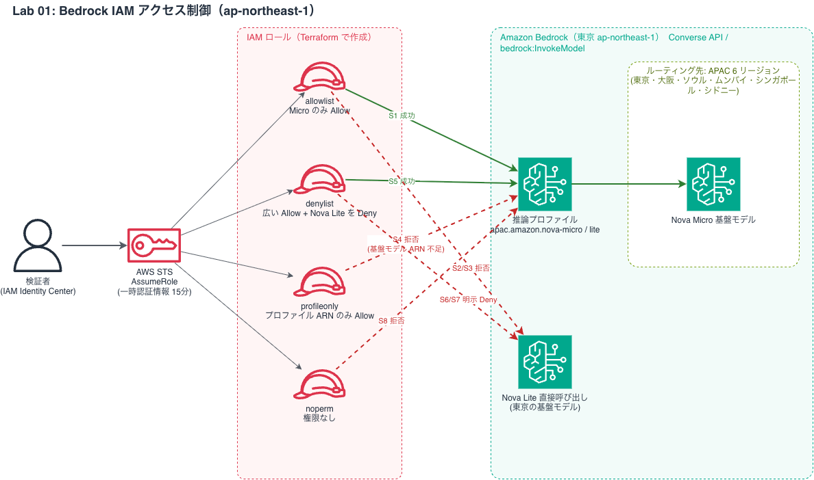

# Lab 01 アーキテクチャ

図は `make_lab01_diagram.py` で生成（AWS 公式アイコン使用。要 graphviz と `pip install diagrams`）。README には Mermaid 版も残している。

判断記録:
- リージョン ap-northeast-1（東京）: 実環境で Micro=プロファイルのみ, Lite=直接+プロファイルを確認。apac. プロファイルのルーティング先は6リージョン
- モデル: 最安クラスの Nova Micro（許可）/ Nova Lite（拒否）
- Converse の認可は bedrock:InvokeModel（専用アクション無し）
- terraform 未導入のため validate 未実施（要確認事項）
