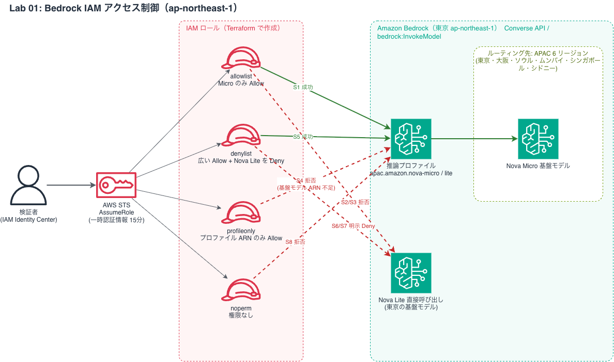

<!--
Qiita 下書き（未公開）。公開前チェックリスト:
 - [ ] GitHub リポジトリ公開後に URL を差し替え（承認後。5章の git clone と14章の2か所）
 - [ ] 構成図を draw.io から PNG で書き出し、Qiita にアップロードして画像パスを差し替え
 - [ ] 東京の Nova Micro 単価を料金ページで確認して「費用」を更新
 - [ ] 請求データ（Cost Explorer）で実額と、拒否呼び出しの課金有無を確認
 - [ ] アカウント ID・ARN が含まれていないことを grep で確認
 - [ ] Qiita への公開は事前承認
-->

# Amazon BedrockのIAMポリシーでモデル利用を制限してみた【東京リージョン・推論プロファイルの落とし穴】

タグ案: `AWS` `Bedrock` `IAM` `Terraform` `生成AI`

## 1. はじめに

生成AIを社内で使わせるとき、「どのモデルを誰に使わせるか」を IAM で制御したくなります。ところが東京リージョンで Amazon Bedrock の Nova Micro を調べると、モデル一覧上は**直接のモデル ID 呼び出し（ON_DEMAND）に非対応で、推論プロファイル（`apac.`）経由が必要**でした。さらに、その IAM 制御はプロファイルの ARN だけでは足りませんでした。

この記事では、IAM ロールを 4 つ作り、Converse API を 8 回呼んで、**許可・暗黙 Deny・明示 Deny** がどう働くかを実測した結果を紹介します。

## 2. 今回検証する課題

- 最小権限の IAM ポリシーで、許可したモデルだけを呼べるか
- 許可されていないモデルを呼ぶと、どんなエラーになるか
- 広い Allow + 明示 Deny で、Deny は本当に勝つか
- 推論プロファイル経由の呼び出しで、必要な権限は何か

## 3. 利用するAWSサービス

| サービス | 役割 |
|---|---|
| Amazon Bedrock（Converse API） | モデル呼び出し（Nova Micro / Nova Lite） |
| IAM | ロールとポリシーによるモデル利用制御 |
| AWS STS | AssumeRole で一時認証情報を取得（長期キーを使わない） |

リージョンは **ap-northeast-1（東京）** です。

### 先に押さえる用語

**推論プロファイル**: モデルを呼ぶときの「入口」です。`apac.` のようなプロファイルを使うと、リクエストが複数のリージョンに振り分けられます。IAM では、**プロファイル自体の ARN** と**振り分け先の基盤モデルの ARN** の両方が評価されます（この記事の核心です）。

**暗黙 Deny と明示 Deny**: IAM は、許可がなければ拒否します（**暗黙 Deny**）。ポリシーに「拒否」と書いて拒否するのが**明示 Deny**で、Allow があっても必ず勝ちます。どちらも `AccessDeniedException` ですが、エラー文が違います。

## 4. AWS構成図

<!-- TODO: Qiita 投稿時は docs/architecture/lab01-architecture.png を記事にアップロードして、下の画像パスを差し替える -->


緑の実線が「許可」、赤の破線が「拒否」です（S1〜S8 は「9. 検証結果」の表を参照）。検証者が STS で 4 つのロールを引き受け、東京の Bedrock に Converse を送ります。Nova Micro は推論プロファイル経由で APAC の 6 リージョンに振り分けられ、Nova Lite は東京で直接呼ぶこともできます。

## 5. 環境構築

前提: Terraform 1.6 以上、AWS CLI v2、Python 3.12 以上、IAM ロールの作成と Bedrock の呼び出しができる AWS 権限（今回は AdministratorAccess の SSO ロール）。**検証用のアカウントで実施してください。**

<!-- TODO: 公開後に URL を差し替え -->
```bash
git clone https://github.com/<user>/aws-ai-security-labs.git
cd aws-ai-security-labs
```

最初に、東京でのモデルの提供方式を確認します。この結果が設計を左右します。

```bash
aws bedrock list-foundation-models --region ap-northeast-1 \
  --query "modelSummaries[?starts_with(modelId,'amazon.nova-micro')].[modelId,inferenceTypesSupported]"
# Nova Micro: ["INFERENCE_PROFILE"]（ON_DEMAND なし）　Nova Lite: ["INFERENCE_PROFILE","ON_DEMAND"]

aws bedrock get-inference-profile --region ap-northeast-1 \
  --inference-profile-identifier apac.amazon.nova-micro-v1:0 --query "models[].modelArn"
# ap-northeast-1/2/3, ap-south-1, ap-southeast-1/2 の 6 リージョン
```

<details>
<summary>AWS 認証と、ロールを引き受ける人の ARN（trusted_principal_arn）の用意</summary>

IAM Identity Center（SSO）の例です。

```bash
aws sso login --profile <プロファイル名>
export AWS_PROFILE=<プロファイル名>      # 以降の terraform / python が同じ認証を使う
aws sts get-caller-identity               # 今、誰として入っているか確認
```

Terraform が作る検証用ロールには、「誰が引き受けてよいか」を決める信頼ポリシーが必要です。そこに入れる**自分の IAM ロールまたはユーザーの ARN** を用意します。

- IAM ユーザー: `arn:aws:iam::<ACCOUNT_ID>:user/<ユーザー名>`
- SSO: `get-caller-identity` の `assumed-role/...` はセッション用 ARN で、信頼ポリシーには使えません。次の形に直します。

```text
arn:aws:iam::<ACCOUNT_ID>:role/aws-reserved/sso.amazonaws.com/<SSOのリージョン>/AWSReservedSSO_<権限セット名>_<ID>
```

`aws iam get-role --role-name AWSReservedSSO_<権限セット名>_<ID> --query Role.Arn --output text` で、正しい ARN を確認できます。

</details>

<details>
<summary>自分の環境に合わせて変える変数</summary>

既定値は**東京と Nova Micro / Lite 用**です（上の調査結果と同じ値）。東京のまま試すなら、`trusted_principal_arn` 以外は変更不要です。

| 変数 | 既定値 | 変えるとき |
|---|---|---|
| `region` | `ap-northeast-1` | 別リージョンで試すとき |
| `profile_prefix` | `apac.` | 地域が違うとき（`us.` など） |
| `routing_regions` | 上記の6リージョン | `get-inference-profile` の結果が違うとき |
| `allowed_model_id` / `denied_model_id` | Nova Micro / Nova Lite | 別のモデルで試すとき |

別の環境では、`routing_regions` を**必ず自分の調査結果に合わせてください**。足りないと、許可したはずのモデルが拒否されます。

</details>

## 6. Terraformの説明

検証用に 4 つのロールを作ります。信頼ポリシーは検証者の SSO ロール 1 つだけ、セッションは 1 時間です。

| ロール | 目的 |
|---|---|
| `allowlist` | Nova Micro だけを許可（許可リスト方式） |
| `profileonly` | プロファイル ARN だけ許可（不足時の挙動確認） |
| `denylist` | 広く Allow + Nova Lite を明示 Deny |
| `noperm` | 権限なし（ベースライン） |

`allowlist` のポリシーです。基盤モデルの ARN にはアカウント ID が入らず（`::`）、プロファイルの ARN には入ります。

```json
{
  "Effect": "Allow",
  "Action": ["bedrock:InvokeModel", "bedrock:InvokeModelWithResponseStream"],
  "Resource": [
    "arn:aws:bedrock:ap-northeast-1:<ACCOUNT_ID>:inference-profile/apac.amazon.nova-micro-v1:0",
    "arn:aws:bedrock:ap-northeast-1::foundation-model/amazon.nova-micro-v1:0",
    "arn:aws:bedrock:ap-northeast-2::foundation-model/amazon.nova-micro-v1:0",
    "arn:aws:bedrock:ap-northeast-3::foundation-model/amazon.nova-micro-v1:0",
    "arn:aws:bedrock:ap-south-1::foundation-model/amazon.nova-micro-v1:0",
    "arn:aws:bedrock:ap-southeast-1::foundation-model/amazon.nova-micro-v1:0",
    "arn:aws:bedrock:ap-southeast-2::foundation-model/amazon.nova-micro-v1:0"
  ]
}
```

アクションは 2 つだけです。Converse / ConverseStream も、この 2 つの権限で認可されます（専用の Converse アクションはありません）。

`denylist` は比較実験用に、`foundation-model/*` などを広く Allow したうえで、`arn:aws:bedrock:*::foundation-model/amazon.nova-lite-v1:0` を Deny します。Deny のリージョンを `*` にしたのは、振り分け先がどのリージョンでも Deny が効くようにするためです。

## 7. Pythonコードの説明

各ロールを `sts:AssumeRole`（有効期限 900 秒）で引き受け、そのロールの権限で Converse を呼びます（短いプロンプト、出力は最大 20 トークン）。拒否されたときは、エラー文で種類を分類します。

| エラー | 分類 |
|---|---|
| `AccessDeniedException` で、文に `no identity-based policy allows` | 暗黙 Deny |
| `AccessDeniedException` で、文に `explicit deny` | 明示 Deny |
| `AccessDeniedException` だが、どちらでもない | 理由不明（SCP など） |
| `AccessDeniedException` 以外（スロットリングなど） | 権限の結果として数えない |

ポイントは、`AccessDeniedException` だけでは暗黙と明示を区別できないことです。区別にはエラー文を見ます。文言は AWS 側で変わりうるため、実測で一致を確認しました。

pytest（モック）は 23 件成功しましたが、これは「こう返ってきたらコードはこう動く」の確認にすぎません。**IAM が実際に制御したことの証明は、実機の結果だけ**です。

## 8. 検証手順

リポジトリのルートから実行します（5章で認証と ARN を用意済みとします）。

```bash
# 1. 変数ファイルを作る（アカウント ID を含むため、コミットしない。.gitignore 済み）
cd 01-bedrock-iam/terraform
echo 'trusted_principal_arn = "<用意した ARN>"' > terraform.tfvars

# 2. 計画を確認してから作成（ロール 4 + ポリシー 3 = 7 リソース）
terraform init
terraform plan -out=tfplan
terraform apply tfplan

# 3. Python が読む出力ファイルを保存
mkdir -p ../../docs/results/raw
terraform output -json > ../../docs/results/raw/tf_outputs.json

# 4. 検証を実行（Converse を 8 回呼ぶ。課金あり）
cd ../..
PYTHONPATH=01-bedrock-iam/src python -m bedrock_iam_lab.cli \
  --tf-output docs/results/raw/tf_outputs.json --confirm-real-calls
```

`--confirm-real-calls` を付けない限り、モデルは呼ばれません。実行すると、次のように表示されます（実際の出力）。`OK` は「期待どおりの結果だった」という意味です。

```text
OK S1 allowlist   apac.amazon.nova-micro-v1:0      expected=ALLOWED actual=ALLOWED
OK S2 allowlist   amazon.nova-lite-v1:0            expected=DENIED_IMPLICIT actual=DENIED_IMPLICIT
OK S3 allowlist   apac.amazon.nova-lite-v1:0       expected=DENIED_IMPLICIT actual=DENIED_IMPLICIT
OK S4 profileonly apac.amazon.nova-micro-v1:0      expected=DENIED_IMPLICIT actual=DENIED_IMPLICIT
OK S5 denylist    apac.amazon.nova-micro-v1:0      expected=ALLOWED actual=ALLOWED
OK S6 denylist    amazon.nova-lite-v1:0            expected=DENIED_EXPLICIT actual=DENIED_EXPLICIT
OK S7 denylist    apac.amazon.nova-lite-v1:0       expected=DENIED_EXPLICIT actual=DENIED_EXPLICIT
OK S8 noperm      apac.amazon.nova-micro-v1:0      expected=DENIED_IMPLICIT actual=DENIED_IMPLICIT
saved: docs/results/raw/lab01.json
saved: docs/results/raw/lab01.csv
```

結果は JSON と CSV に保存され、エラー文中のアカウント ID は自動で `************` に置き換わります。

> 余談: 最初の `terraform apply` は失敗しました。IAM ロールの `description` に日本語を入れていたためです（`ValidationError`）。`validate` / `plan` では検出されず、実際の API 呼び出しで初めて分かります。description は ASCII にしましょう。

## 9. 検証結果

| ID | ロール | 呼び出し先 | 結果 | 確認したこと |
|---|---|---|---|---|
| S1 | allowlist | Micro（`apac.`） | **成功** | 許可したモデルは呼べる |
| S2 | allowlist | Lite 直接 | 暗黙 Deny | Allow にないモデルは拒否される（直接呼び出し） |
| S3 | allowlist | Lite（`apac.`） | 暗黙 Deny | 同上（プロファイル経由） |
| S4 | profileonly | Micro（`apac.`） | 暗黙 Deny | プロファイル ARN だけの Allow で足りるか |
| S5 | denylist | Micro（`apac.`） | **成功** | 広い Allow なら呼べる |
| S6 | denylist | Lite 直接 | 明示 Deny | Deny は Allow に勝つか（直接呼び出し） |
| S7 | denylist | Lite（`apac.`） | 明示 Deny | プロファイル経由でも Deny が効くか |
| S8 | noperm | Micro（`apac.`） | 暗黙 Deny | 権限なしの場合（ベースライン） |

8 シナリオすべて期待どおりでした（S4・S7 は事前に「仮説」としていた項目です）。実際のエラー（アカウント ID 伏せ）です。

```text
# 暗黙 Deny (S4 profileonly)
... is not authorized to perform: bedrock:InvokeModel on resource:
arn:aws:bedrock:ap-southeast-2::foundation-model/amazon.nova-micro-v1:0
because no identity-based policy allows the bedrock:InvokeModel action

# 明示 Deny (S7 denylist)
... is not authorized to perform: bedrock:InvokeModel on resource:
arn:aws:bedrock:ap-southeast-2::foundation-model/amazon.nova-lite-v1:0
with an explicit deny in an identity-based policy
```

## 10. 考察

**1. プロファイル ARN だけでは足りない（S4）**
プロファイル ARN を Allow していたのに拒否され、拒否されたのは**振り分け先の基盤モデル ARN**でした。しかも東京ではなくシドニーです。公式ドキュメントにも「プロファイルと、宛先すべてのリージョンの基盤モデルを許可する」という要件がありますが、エラーを見ると納得感があります。

**2. 明示 Deny は、プロファイル経由でも Allow に勝つ（S7）**
広い Allow があっても、基盤モデルへの Deny が効きました。Deny のリージョンは `*` にしておく必要があります。東京だけに Deny を書くとどうなるかは、今回は検証していません。

**3. 直接呼び出しとプロファイル経由では、評価される ARN が違う（S2 と S3）**
直接は基盤モデル ARN、プロファイル経由はプロファイル ARN と基盤モデル ARN が評価されます。Allow/Deny は経路ごとに考える必要があります。

**実務では**、基本は allowlist 方式（個別 ARN の許可）にすると、新しいモデルが自動で使えるようになる事故を防げます。Deny は SCP で組織全体のガードレールとして併用すると堅牢です。宛先リージョンの列挙は、AWS 側の変更に追従する運用が要ります（宛先が増えると、Allow にないリージョンで拒否される可能性があります。今回は未検証です）。

## 11. セキュリティ上の注意点

- `denylist` ロールの広い Allow は**比較実験専用**です。本番に持ち込まないでください。
- リージョンを SCP で制限している組織では、プロファイルの宛先が制限リージョンに入ると拒否される場合があります（公式ドキュメントの注意事項）。
- エラー文にはロール名やアカウント ID が含まれます。ログや記事に載せるときはマスクしてください。
- 条件キー `bedrock:InferenceProfileArn` で「基盤モデルはこのプロファイル経由のときだけ許可」と絞る方法が公式ドキュメントにあります。今回は**試していません**。

**確認できていないこと**: 各シナリオは 1 回ずつの実行です。実際にどのリージョンで処理されたかは確認しておらず、振り分け先が固定とは限りません。成功した S1・S5 が他の宛先でも成功する保証にはなりません。SCP・権限境界など他の制御との組み合わせも未検証です。

## 12. 費用

- IAM ロール・ポリシーは無料で、継続課金されるリソースはありません。
- 成功した呼び出しは 2 回（S1・S5）で、各 入力 7 / 出力 2 トークンでした。
- 参考単価（AWS 公式ブログ、2025 年 5 月・米国東部 Ohio）の Nova Micro は入力 $0.000035 / 出力 $0.00014（1,000 トークンあたり）で、2 回で**約 $0.000001** の計算です。
- 東京の geo クロスリージョン推論の単価は、<!-- TODO: 料金ページで確認して記入 -->未確認です。
- 拒否された呼び出しはトークン数 0 でしたが、課金の有無は <!-- TODO: Cost Explorer で確認 -->未確認です。

後片付けは `terraform destroy` です。

```bash
terraform destroy
aws iam list-roles --query "Roles[?starts_with(RoleName,'lab01-bedrock-')].RoleName"   # [] なら完了
```

## 13. まとめ

- 東京の Nova Micro は推論プロファイル経由。IAM では**プロファイル ARN と、宛先すべての基盤モデル ARN**が必要
- 暗黙 Deny と明示 Deny は、エラー文で区別できる。明示 Deny は広い Allow に勝つ
- 「モックが通った」と「IAM が制御できた」は別物。実機で確かめる

次回は、Bedrock の利用履歴を CloudTrail と CloudWatch で追跡します。

## 14. GitHubコードへのリンク

<!-- TODO: 公開後に差し替え（公開は事前承認） -->
`https://github.com/<user>/aws-ai-security-labs`（`01-bedrock-iam/`）

## 参考

- [Geographic cross-Region inference（IAM ポリシー要件）](https://docs.aws.amazon.com/bedrock/latest/userguide/geographic-cross-region-inference.html)
- [Supported Regions and models for inference profiles](https://docs.aws.amazon.com/bedrock/latest/userguide/inference-profiles-support.html)
- [Amazon Nova Micro モデルカード](https://docs.aws.amazon.com/bedrock/latest/userguide/model-card-amazon-nova-micro.html)
- [Amazon Bedrock 料金](https://aws.amazon.com/bedrock/pricing/)
